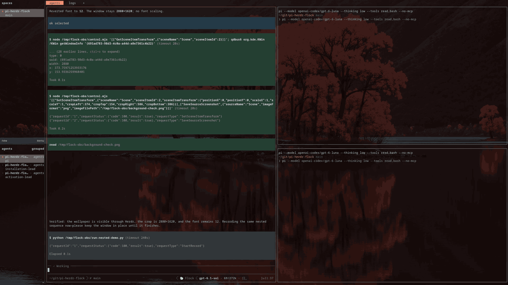

# pi-herdr-flock

<p>
  <a href="https://www.npmjs.com/package/pi-herdr-flock"></a>
  <a href="https://www.npmjs.com/package/pi-herdr-flock"></a>
  <a href="LICENSE"></a>
  <a href="https://pi.dev/packages/pi-herdr-flock"></a>
</p>

Guides Pi to delegate work to a visible flock of Herdr terminals.

<p align="center">
  
  <br>
  <strong>Demo:</strong> Pi delegates to two visible workers, each launches a child,<br>
  and all four worker panes close after results are collected.
</p>

Flock loads `herdr --skill` at session start and tells Pi to prefer visible Herdr workers when delegation is useful. It does not launch workers itself and stays inactive outside Herdr.

## Install

Requires Pi **1.1.0 or later (1.x)**, Node.js **22.19.0 or later**, and `herdr` on PATH. Tests cover Pi **1.1.0** and **1.5.0**; CI also checks the latest Pi **1.x**.

```sh
pi install npm:pi-herdr-flock
```

Run Pi inside Herdr. If Pi was already running, use `/reload`.

## Status

The footer shows `🐑 Flock` when instructions have loaded successfully. Compatible with `pi-minimal-footer` when extension statuses are enabled.

Customize the label in `~/.pi/agent/settings.json` (or project `.pi/settings.json`):

```json
{
  "piHerdrFlock": {
    "footerStatus": "🐑"
  }
}
```

Run `/reload` after editing settings. An empty string hides the label without disabling the extension. Project settings override user settings. If no string is configured, the default is `🐑 Flock`.

**Deprecated:** `PI_HERDR_FLOCK_STATUS` still works as a fallback when no string setting is configured. Use `piHerdrFlock.footerStatus` in Pi settings instead.

If loading fails, Flock stays inactive and Pi shows a warning explaining the failure when a UI is available. Check that `herdr --skill` works on PATH, then use `/reload`. Reload also picks up updated Herdr instructions.

## Delegation limits

Flock guides how Pi delegates; it is **not a sandbox or a technical security boundary**.

- **You stay in control.** Pi must still follow instructions like “don't delegate” or “don't edit files.”
- **Workers stay local by default.** Flock tells Pi to start workers in your current project and Herdr workspace.
- **Herdr's own rules still apply.** Flock adds no extra approval requirements for other projects or Git worktrees.
- **Clean up afterward.** Pi should close workers and panes it created after verifying results, leaving existing panes untouched.
- **No hidden workers.** If Herdr cannot run a visible worker, Pi should tell you—not quietly use a hidden one.

Flock's instructions also use part of the model's context window. Loading a separate Herdr skill can duplicate those instructions and consume extra context tokens.

See [the technical vision](https://github.com/Ryu-CZ/pi-herdr-flock/blob/main/VISION.md) for development and design details.

MIT licensed.
