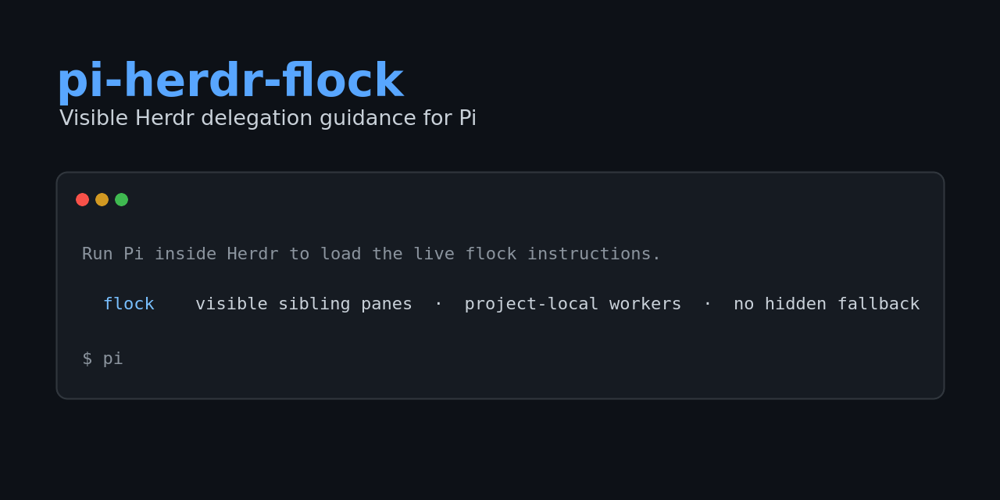

# pi-herdr-flock

<p>
  <a href="https://www.npmjs.com/package/pi-herdr-flock"></a>
  <a href="https://www.npmjs.com/package/pi-herdr-flock"></a>
  <a href="LICENSE"></a>
  <a href="https://pi.dev/packages/pi-herdr-flock"></a>
</p>



Guides Pi to delegate work to a visible flock of Herdr terminals.

## What it does

- Loads Herdr's current instructions into Pi
- Encourages visible sibling-pane or project-local delegation
- Keeps focus, verification, and cleanup explicit
- Remains inactive outside Herdr
- Never launches workers automatically

## Best for

- Users running Pi inside Herdr
- Teams that want visible, auditable worker delegation
- Workflows where focus preservation and verification matter

## Not for

- Automatic agent spawning
- Hidden or background workers
- Running outside Herdr

## Install

Requires Pi **1.1.0+ (1.x)**, Node.js **22.19+**, and `herdr` on PATH.

This extension does not create or launch agents. It provides guidance for using visible Herdr workers through Herdr.

```sh
pi install npm:pi-herdr-flock
```

Run Pi inside Herdr, then use `/reload` if Pi was already running. Outside Herdr, the extension stays inactive.

## Status

The footer shows `🐑 flock` when instructions have loaded successfully. Compatible with `pi-minimal-footer` when extension statuses are enabled.

Customize the label before launching Pi:

```sh
PI_HERDR_FLOCK_STATUS="my flock" pi
```

An empty value hides the label without disabling the extension.

If instructions cannot load, Pi warns when UI is available and leaves Flock inactive. Check that `herdr --skill` works, then `/reload`. Reload also picks up updated Herdr instructions.

## Delegation limits

Enabling Flock expresses a preference for otherwise-permitted delegation through visible sibling panes or project-local tabs. Explicit no-delegation instructions still apply; other projects, worktrees, and unrelated Herdr operations need separate authorization. No hidden-worker fallback is authorized.

Worker selection, focus preservation, verification, and cleanup are model guidance—not enforced guarantees. Instructions consume context tokens, and separately loaded Herdr skills may duplicate them.

## Development

```sh
npm ci
npm test
npm run check
npm pack --dry-run
```

Try this checkout without installing: `pi -e ./extensions/index.ts`.

See [the technical vision](./pi-herdr-flock) for runtime contracts, delegation policy, and verification coverage.

MIT licensed.
